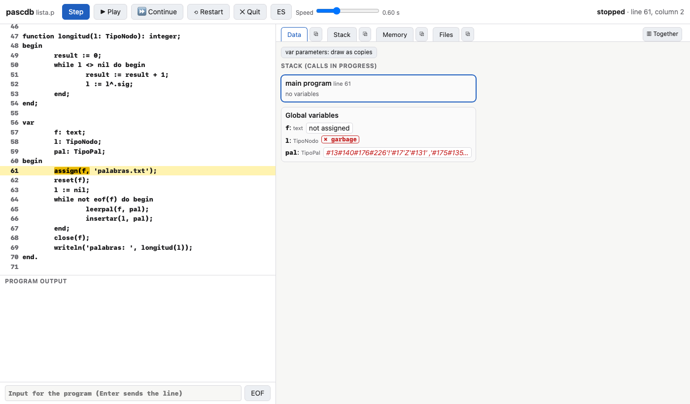
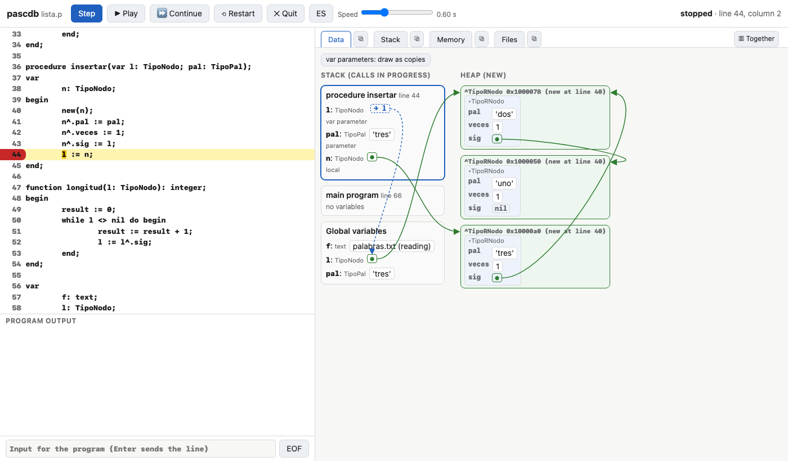
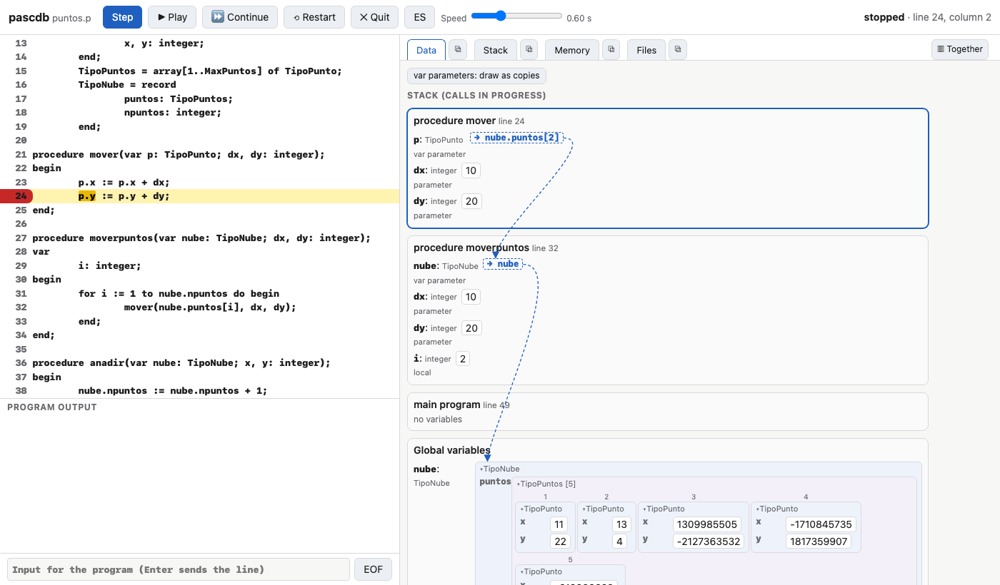
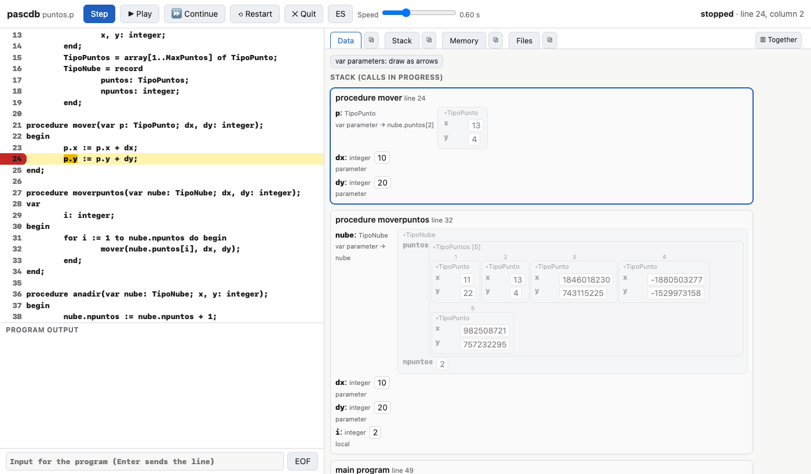
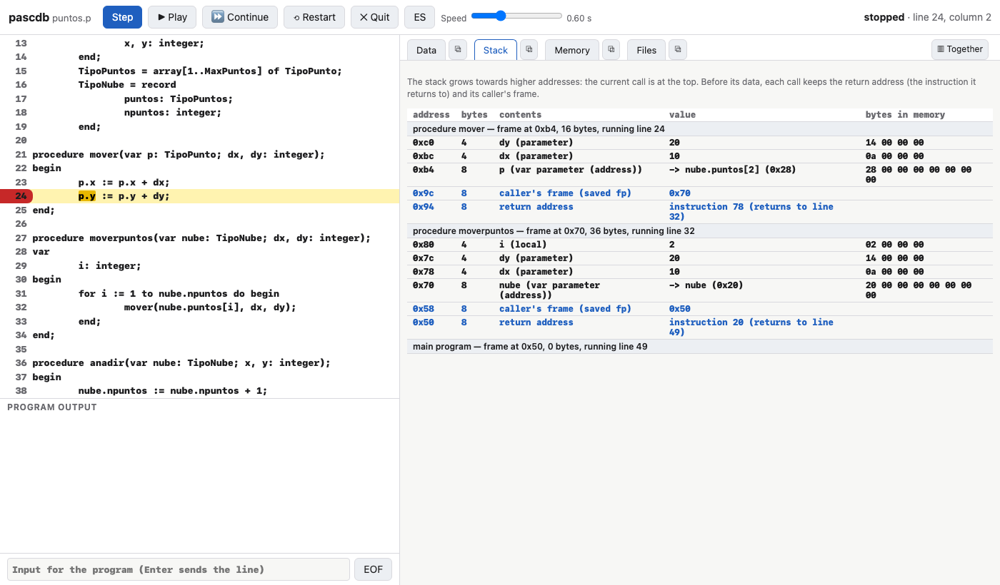
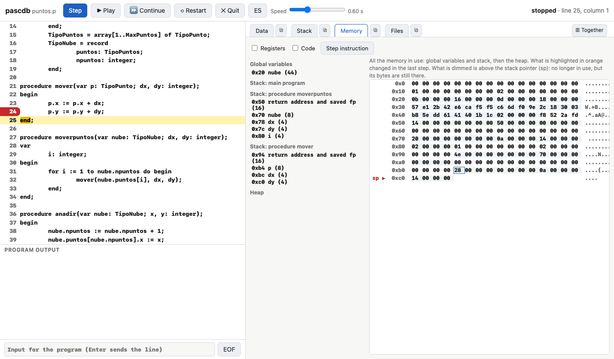
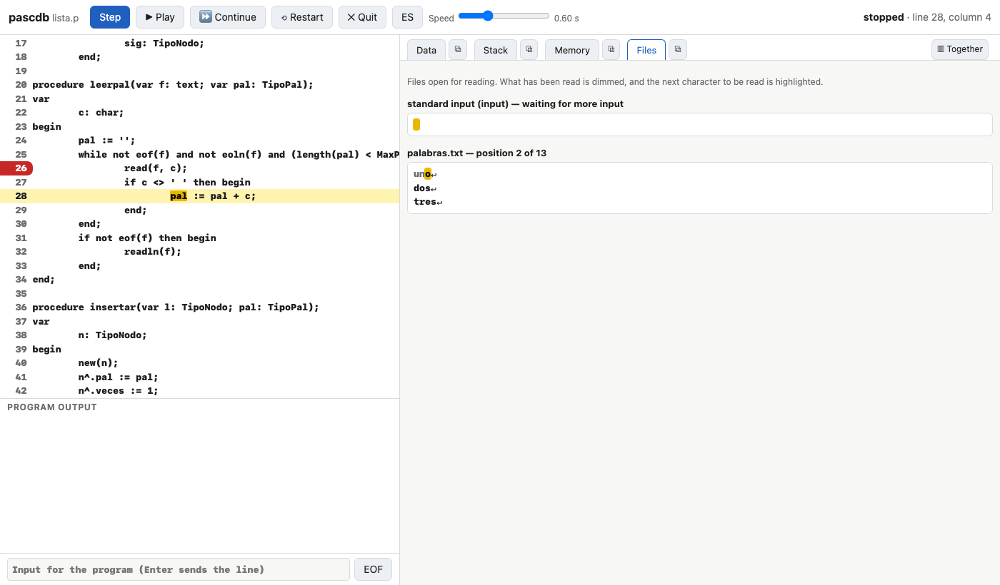
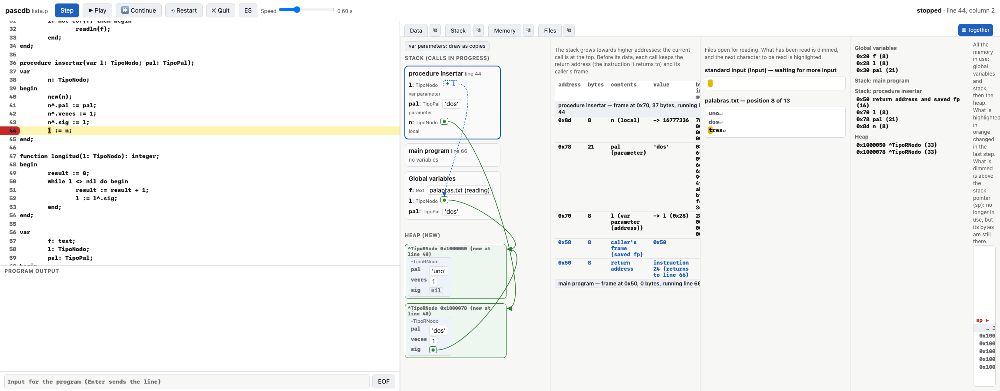
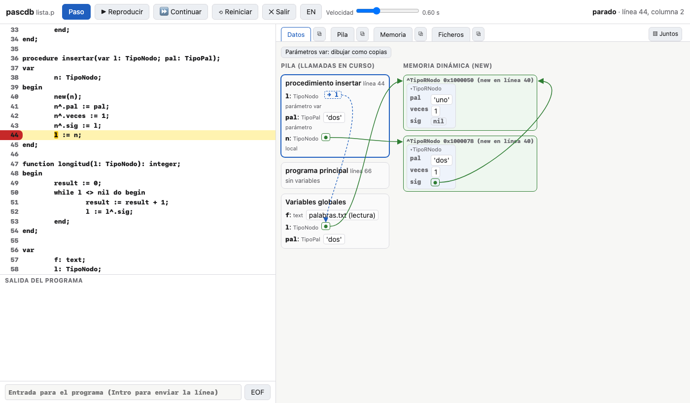
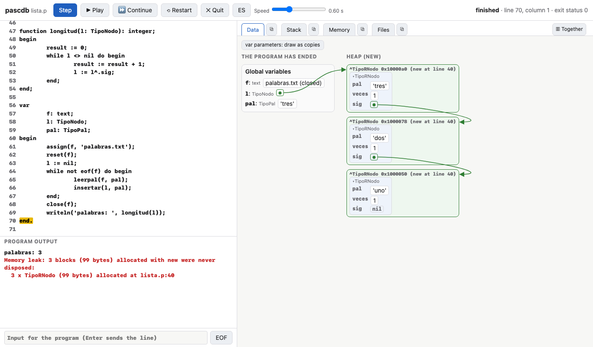

# pasc and pascdb: user guide

**pasc** runs Pascal programs written in the restricted Free Pascal of the
course. It checks the program, reports errors with their file, line and
column, and runs it the way fpc would, with extra help for spotting
common mistakes. **pascdb** runs a program step by step in the browser,
drawing its variables, the stack, the memory and the files it reads.

To install them, see `INSTALAR.md` (Spanish), also included as
`INSTALAR.pdf` with every installer. The example programs used in this
guide are in `docs/examples`.

## 1. Running a program

```
pasc prog.p
```

compiles `prog.p` and runs it. The program reads from the keyboard (or
from a file with `pasc prog.p < datos.txt`) and writes to the terminal.
Files the program opens with `assign` are relative to the current
directory.

When the program ends, pasc's exit status is the program's: 0, the code
given to `halt`, or the number of the run-time error. Check it with
`echo $?` (macOS, Linux) or `echo %errorlevel%` (Windows).

### Options

| Option | Effect |
|---|---|
| `-c` | only compile (check) the program; do not run it |
| `-w` | do not report style warnings (section 5) |
| `-z` | uninitialised memory is zero instead of random |
| `--seed N` | repeat the same random contents for uninitialised memory |
| `-g` | allow global variables before procedures and functions |
| `-L` | do not enforce the limits on loops and nesting (section 2) |
| `-R` | relaxed: the course rules (indentation, limits, globals last, I/O in functions, `ord` comparisons) are only warnings |
| `--datos` | every file the program opens is `datos.txt` (used by pasgrade) |
| `-S` | print the bytecode the program compiles to |
| `--stack MB` | stack size in megabytes (default 16) |
| `--version` | print the version |

## 2. Compile errors

The program is checked completely before it runs. The first error stops
compilation and is reported as `file:line:column: error: message`, with
the same wording fpc uses where there is one:

```
$ pasc prueba.p
prueba.p:6:7: error: Incompatible types: got "ShortString" expected "LongInt"
```

Go to that line and column in the editor. Besides fpc's own errors, pasc
rejects some things fpc accepts, because they are bad practice in the
course:

* **Bad indentation.** The statements of a block must be indented more
  than the line that opens the block and all start at the same column;
  `end`, `else` and `until` line up with the line that opened them. Tabs
  count as 8 columns.

  ```
  ind.p:7:4: error: bad indentation: statements of the same block must start at the same column
  ```

* **Input/output in a function.** Functions compute values; reading,
  using files or calling a procedure that does is an error.

  ```
  io.p:7:8: error: Functions must not do input/output (readln); use a procedure
  ```

  `write` and `writeln` are allowed in a function, with a warning, so you
  can print values while debugging.

* **Comparing characters with `ord`.**

  ```
  ordc.p:7:12: error: Do not use ord to compare characters: compare the characters directly (c1 >= c2)
  ```

* **Global variables before procedures.** Global variables are the main
  program's variables: they are declared after every procedure and
  function, right before the main program, so routines cannot use them.
  Constants and types can go anywhere. `-g` turns this check off.

  ```
  glob.p:4:2: error: global variables must be declared after all procedures and functions, just before the main program (pasc -g allows them earlier)
  ```

* **Too many loops or too much nesting.** In each procedure, function and
  the main program: at most 4 loops, loops nested at most 2 deep, control
  structures (`if`, `case`, `while`, `repeat`, `for`) nested at most 6
  deep (an `else if` does not count as nesting), and at most 6 `if`
  statements in a row (an `if ... else if ...` chain counts as one).
  Move the inner part to a procedure or function.

  ```
  bucles.p:8:4: error: loops nested 3 deep in the main program (the limit is 2): move the inner loop to a procedure or function (-L allows it)
  ```

  These limits are set in `pasclib/limits.py`. `-L` turns them into
  style warnings.

* **Anonymous types.** Every type used in a variable, a typed constant, a
  record field or an array element must have a name: declare it in a
  `type` section and use the name. Array indexes may be subranges
  written in place (`array[1..N] of TipoNum`), and `string[n]` and
  `^T` may be written anywhere.

  ```
  tipos.p:23:10: error: declare a type for this array and use its name (anonymous types are not allowed) (-L allows it)
  ```

  This rule is listed with the other enforced limits in
  `pasclib/limits.py` (`named_types`), and `-L` turns it into a warning.

Unlike standard Pascal, a `case` branch may have several statements
without `begin` and `end`; they go on until the next label, `else` or
`end`, and are indented under their label:

```
case c of
Rojo:
	writeln('rojo');
	n := n + 1;
Verde, Azul:
	writeln('otro');
end;
```

The standard functions of Pascal are available: `abs`, `sqr`, `sqrt`,
`sin`, `cos`, `arctan`, `exp`, `ln`, `frac`, `int`, `trunc`, `round`,
`odd`, `pi`, `random` (with no argument, a real in [0, 1); `random(n)`,
an integer in [0, n)) and `randomize`. Without `randomize`, `random`
gives the same numbers on every run, the same ones fpc gives. With `uses
math` you also get `intpower`, `**` and `mod` on reals.

pasc also rejects everything outside the course's subset of the language
(sets, dynamic arrays, nested procedures, `with`, `exit`, `break`, `inc`,
...), with a message saying it is not supported.

## 3. Warnings

Warnings do not stop the program. pasc always reports:

* a function whose result does not seem to be set;
* a procedure that only computes a value for its single `var` parameter,
  which should be a function:

  ```
  est.p:6:1: warning: procedure "doble" only computes a value for var parameter "r": it should be a function
  ```

* `write`/`writeln` inside a function (fine while debugging);
* lines indented with spaces in a file that uses tabs;
* a file opened again while it was already in use, and files never closed
  (reported when the program ends).

## 4. Run-time errors and teaching aids

### Run-time errors

A run-time error stops the program and reports the error number, the
line, and the chain of calls that led there. The output written so far is
kept. This is `docs/examples/errores.p`:

```
$ pasc errores.p
1187813557
Runtime error 201 at errores.p:33: Range check error
  in main program
```

The numbers are fpc's: 201 range check (an index or a value out of
range), 215 arithmetic overflow, 200 division by zero, 216 bad pointer
(for example `nil^`), 202 stack overflow (often infinite recursion), 2
file not found, 106 invalid number read, and so on.

### Uninitialised variables hold garbage

The first line printed above, `1187813557`, is wrong: `suma` adds to
`s` without setting it to 0 first. pasc fills every variable that has
not been given a value (global and local variables, function results,
blocks from `new`) with random bytes, so a missing initialisation shows
up as a strange result instead of passing unnoticed. fpc sets global
variables to zero, and so does `pasc -z`, which here prints 6.
`--seed N` repeats the same garbage from one run to the next.

### Memory leaks

When the program ends, pasc reports the memory allocated with `new` that
was never released with `dispose`, grouped by the line that allocated it.
`docs/examples/lista.p` builds a list and never frees it:

```
$ pasc lista.p
palabras: 3
Memory leak: 3 blocks (99 bytes) allocated with new were never disposed:
  3 x TipoRNodo (99 bytes) allocated at lista.p:40
```

### `stack()`: printing the state of the program

Calling `stack()` anywhere prints, on standard error, every procedure and
function in progress with its parameters, locals and result, then the
global variables and the heap:

```
--- stack() at pila.p:13 ---
   procedure mostrar, line 13
      p: TipoPunto = (x: 3; y: 4)  {parameter}
      total: integer = 3  {var parameter}
      k: integer = -834717444  {local}
   main program, line 23
   global variables
      p: TipoPunto = (x: 3; y: 4)
      t: integer = 3
   heap: 0 blocks in use (0 bytes)
---
```

(`k` has not been given a value: its contents are garbage.) `stack(1)`,
`stack(2)`, ... print more detail: one line per field or element, nested
structures one level deeper, pointers followed further and more array
elements. Long runs of equal or garbage elements are abbreviated.

### Big value parameters

An array or record passed by value that the procedure never changes is
not copied. It behaves as a value parameter, but passing big arrays costs
nothing and cannot overflow the stack.

## 5. Style warnings

pasc also reports warnings about style (unless run with `-w`), the kind of thing a teacher
would point out. For example:

```
$ pasc est.p
est.p:4:2: warning: constant "max" should start with an uppercase letter
est.p:6:1: warning: procedure "doble" only computes a value for var parameter "r": it should be a function
est.p:13:2: warning: returning true or false from both branches of an if: return the condition instead
est.p:14:3: warning: write the body of this "if" between begin and end
est.p:16:3: warning: write the body of this "else" between begin and end
est.p:20:2: warning: variable "R" should be written in lowercase
est.p:23:14: warning: "= True" is not needed: use the condition itself
20
```

The checks are:

* lines longer than 100 columns;
* procedure, function or main program bodies longer than 40 lines;
* more than 6 parameters;
* two routines with the same body (up to the names of their variables);
* the same statement or group of statements repeated several times in a
  row, perhaps instead of a loop or a procedure;
* `x = True`, `x <> False` and similar comparisons;
* `if c then x := true else x := false`, which should be `x := c`;
* bodies of `if`, `else`, `while` and `for` not written between `begin`
  and `end`;
* `end else` on one line: `else` goes on its own line, right under the
  `end`; `begin` and `end` of a block on the same line (allowed only for
  the statements of a `case` branch); `begin` on a line of its own after
  `then`, `do` or `else` (it goes at the end of that line);
* a `for` loop that searches for something and keeps going after finding
  it (it should be a `while` or a `repeat`);
* a routine that takes an array and an index used only as `a[i]` (pass
  the element), or an array and its number of elements (keep both in a
  record);
* naming: constants, enumeration values and types start with an
  uppercase letter; variables, parameters, fields and routines are all
  lowercase; a name is always written as it was declared.

The limits (100, 40, 6, ...) and the list of checks are in one table,
`pasclib/limits.py`, which teachers can adjust.

### Your own limits (`~/.pasclimits`)

An installed pasc can be tuned without touching `limits.py`: a plain text
file `.pasclimits` in the home directory (`$HOME/.pasclimits` on macOS and
Linux, `%USERPROFILE%\.pasclimits`, e.g. `C:\Users\ana\.pasclimits`, on
Windows) overrides its values, one `limit: value` per line:

```
# my limits
line_length: 120
loops: 6
begin_end: off
enforced: loops, nested_loops
```

Values are numbers, `on`/`off` (or `true`/`false`, `yes`/`no`), `none`,
and, for `enforced`, a list of limit names. Lines starting with `#` are
ignored, and a wrong line is reported as a warning and ignored. The
environment variable `PASCLIMITS` names another file instead (empty: no
file); the test suites set it empty.

## 6. pascdb: watching a program run

```
pascdb prog.p
```

compiles the program (errors and warnings are reported as with pasc) and
opens a page in the browser. pascdb is a small web server that runs only
on your computer; it prints the address of the page in case the browser
does not open by itself. The **Quit** button, or Ctrl+C in the terminal,
ends it. Options: `-g`, `-L` and `-w` as in pasc, `--port N` to use a fixed port, and
`--no-browser` to only print the address.

The captures below use `docs/examples/lista.p`, which reads the words of
`palabras.txt` into a linked list, and `docs/examples/puntos.p`, which
moves points stored in a record with an array. To try them, run `pascdb
lista.p` in `docs/examples`.

### 6.1 The page



* The **toolbar** has the buttons that run the program, the **ES/EN**
  language button, the speed for Play and, on the right, the status
  (stopped, running, waiting for input, finished), the line and column of
  the next statement and, at the end, the exit status.
* On the **left** is the source. The line about to run is highlighted, and
  so is the exact statement within it (here, `assign(f,` on line 61).
  Below it are the program's **output** and an **input line**: what you
  type there and send with Enter is what the program reads; **EOF**
  ends the input (`eof` becomes true).
* On the **right** are four tabs: **Data**, **Stack**, **Memory** and
  **Files**.

The program has not run anything yet: it stops before the first
statement.

### 6.2 Running

| Button | Key | Effect |
|---|---|---|
| **Step** | Enter or F10 | run one statement, going into procedures and functions |
| **Play** / **Pause** | Space | run statement after statement on its own, at the chosen speed |
| **Continue** | | run until the next breakpoint, or to the end |
| **Restart** | | start the program again |
| **Quit** | | end pascdb |

Click a line number to set a **breakpoint** there (it turns red); click
it again to remove it. Continue stops before running a line with a
breakpoint.

### 6.3 Data: variables, records, arrays and pointers

Here a breakpoint was set at line 44 of `lista.p` (`l := n;`, in
`insertar`) and Continue was pressed three times, so the program is
inserting its third word:



* Each procedure or function in progress is a box, the current one on
  top (highlighted), with its parameters, locals and the line it is
  running. Below them come the main program, the global variables and
  the blocks allocated with `new` (**Heap**), each labelled with its type,
  address and the line that allocated it.
* Pointers are drawn as arrows, so the linked list appears as a chain:
  the global `l` points to the first node, whose `sig` points to the next,
  until `nil`. The new node `n` is already linked to the old first node
  and will become the first one when `l := n` runs.
* The parameter `l` of `insertar` is a `var` parameter: it is not a copy,
  but a reference to the argument, drawn as a dashed arrow from `→ l` to
  the global variable `l`.
* Values that are garbage (never set) are marked, and so are dangling
  pointers (to disposed memory).
* What the last step changed is highlighted in orange, and the pane
  scrolls to show it.
* Records and arrays can be collapsed and expanded by clicking their
  header. Strings longer than 40 characters are cut; click one to see it
  whole.

`var` parameters can be shown in two ways, chosen with the button at the
top of the pane. As arrows (above, and below for `puntos.p`), where a
`var` parameter whose argument was itself a `var` parameter of the caller
points to it, and from there on to the original variable:



In `puntos.p`, `mover` was called with `nube.puntos[2]`, an element of
the `var` parameter `nube` of `moverpuntos`, which refers to the global
`nube`. Or as faded copies of the argument's value, which is easier to
read when there are many:



### 6.4 Stack: the stack in memory



The Stack tab shows the stack as it really is in memory, with the current
call on top. For every call it lists each slot with its address, size,
what it holds and its bytes: value parameters hold a copy of their value
(`dx`, `dy`), `var` parameters hold the address of the argument (`p`
holds 0x28, the address of `nube.puntos[2]`), and locals hold their
value. Before each call's data come the **return address** (the
instruction, and line, where the caller continues) and the **caller's
frame** (saved frame pointer), which is how the program returns from a
call.

### 6.5 Memory: the bytes



The Memory tab is a dump of all the memory the program uses, in
hexadecimal and as characters: global variables, the stack and then the
heap. The list on the left names every variable, stack slot and heap
block; clicking one (there or in the Data tab) scrolls the dump to its
bytes, which are shaded. The bytes changed by the last step are
highlighted. The stack pointer is marked `sp ▶`: the bytes above it are
dimmed, because they belonged to calls that have returned. They are no
longer in use, but they are still there, which is why a new call finds
garbage in its local variables.

### 6.6 Files: what the program reads



The Files tab shows each text file open for reading, and the standard
input, with what has already been read dimmed and the next character to
be read highlighted. Here `leerpal` has read `un` from `palabras.txt` and
`o` is next. `↵` marks the ends of line, which is what `eoln` and
`readln` deal with.

### 6.7 Several panes at once

Each tab has a ⧉ button that opens it in its own window, and **Together**
shows all of them side by side:



All the windows follow the same run, and a variable picked in one is
shown in the Memory pane of all of them. Quitting closes them all.

### 6.8 Spanish or English

The **ES**/**EN** button switches the page between Spanish and English.
The browser remembers the choice.



### 6.9 When the program ends



When the program ends, the status shows the exit code, the output shows
pasc's messages (here the memory leak report) and the Data tab keeps the
global variables and the heap as the program left them: the three nodes
of the list, never disposed. Restart runs the program again; Quit ends
pascdb.

### 6.10 Tips

* To get quickly to the interesting part, set a breakpoint and use
  Continue, then Step from there.
* To watch a loop, use Play and adjust the speed.
* If the program reads from the keyboard, the status says "waiting for
  input" and the input line is highlighted: type the line and press
  Enter.
* Uninitialised memory is random, as with pasc, so garbage looks
  different on every run.
